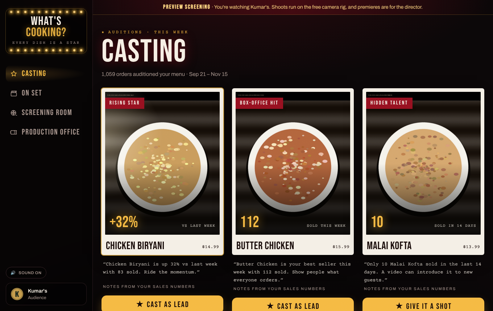

# What's Cooking?

**A restaurant's dish photos and sales data → a published YouTube Short in about a minute. No editing, capped cost.**

What's Cooking? reads a restaurant's sales export to decide which dish to promote, writes a hook, captions and voiceover
grounded in the real menu, turns a single dish photo into a vertical video (AI motion with Google Veo, or a free Ken Burns
render), and publishes it to the restaurant's YouTube channel. The owner sets a monthly budget and the system never exceeds it.

> Rebuild of LLMSoftware × UT Dallas Hackathon (Nov 2026) Team 6 "AI Video Marketing" (Special Recognition).
> The hackathon version faked the videos; this one generates them for real.

**Every dish is a star.** The app is themed as a movie studio: sales data holds the casting call, the dish photo becomes the star, and the Short premieres on YouTube.

| Pillar | Page (in the app) | Job |
|---|---|---|
| Insights | **Casting** `/insights` | Sales CSV → Rising star / Box-office hit / Hidden talent picks with plain-English reasons → **Cast as lead** |
| Studio | **On Set** `/studio` | One dish → one finished 9:16 Short. Clapperboard **Action!** → Read-through → Script → Lights · Camera → Voice → Final Cut, then a curtain reveal |
| Library | **Screening Room** `/library` | Poster wall of every Short, download, one-click YouTube **premiere** |
| Brand & Budget | **Production Office** `/settings` | Studio logo and titles on every render, production budget meter, daily Veo limit, monthly cap, **Indie mode** (free) |



## Architecture

```
 Browser (Next.js on Vercel)  /insights /studio /library /settings
        │  REST JSON (+ poll GET /jobs/{id} every 1.5 s)
        ▼
 FastAPI (Docker, ffmpeg)  ── one process, 2 async workers
   ├─ gemini.py   analyze_photo · write_script · insight_reasons   → Gemini Flash (structured JSON)
   ├─ scripts.py  grounding validator · repair retry · template fallback
   ├─ veo.py      image→video (8 s, 9:16, 720p)                     → Veo (paid, capped)
   ├─ budget.py   reserve → commit / release on UsageLedger         (atomic Veo guard)
   ├─ tts.py      edge-tts (word timings) → gTTS → captions-only
   ├─ render.py   Ken Burns · ASS captions · end card · ffmpeg assemble
   ├─ insights.py CSV aliases · fuzzy menu match · ranking
   ├─ youtube.py  OAuth web flow · resumable upload
   └─ SQLite + media on a persistent volume (/data)
```
Veo is an optional upgrade inside the Visuals stage. Every stage that touches a paid, slow or unofficial service has a
free fallback, so the core loop (photo → Short) never depends on one.

## Quick start (local)

Requirements: Python 3.12+, Node 20+, ffmpeg.

```bash
make setup                 # venv + pip install, npm install
cp .env.example .env       # then fill in (see docs/SETUP.md); works with everything blank
make secrets               # paste APP_SECRET + OWNER_TOKEN into .env
make seed                  # Kumar's demo restaurant: menu, photos, 8 weeks of sales, brand kit, 2 videos
make back                  # API → http://localhost:8000
make front                 # Web → http://localhost:3000
```

With no API keys at all, the app still works end to end. Scripts come from the menu template, visuals are free mode, and
photo matching asks you to pick the dish. Add `GEMINI_API_KEY` for AI scripts, photo matching and Veo.

| Switch | Effect |
|---|---|
| `DEMO_MODE=1` | Visitors without the owner token get a read-only demo: free mode only, no publishing, banner shown |
| `MOCK_PIPELINE=1` | Fake pipeline with realistic stage timings (frontend work without ffmpeg/AI); `MOCK_FAIL_RATE=0.1` exercises failure UI |
| `DEMO_CACHE=1` | An owner Veo job for the seeded Chicken Biryani replays `seed/hero_veo_short.mp4` (a real Veo render made once with `make hero`) |

Owner mode: open **Brand & Budget**, enter `OWNER_TOKEN`, and Veo, publishing, sales import and settings unlock on that device.

## Cost control (3 layers)

Veo is billed per second, and Google's billing data lags by about 10 minutes, so one guard is not enough:

1. **Prepaid credits, auto-reload off.** The Gemini API key's billing account is prepaid. When credits run out, calls fail
   instead of billing more.
2. **AI Studio project spend cap.** A monthly cap on the project, set about 20% *below* the real budget to absorb billing lag.
3. **In-app `UsageLedger` guard** (`backend/app/services/budget.py`). Before every Veo call, the pipeline atomically *reserves*
   a clip. It refuses when free mode is on, today's clips ≥ the daily limit, or month-to-date estimated spend + this clip
   > the monthly cap. A finished clip is *committed*; a failed one is *released*. The job then falls back to free mode and says why.
   Tested: the 11th clip is refused when the limit is 10, and concurrent requests at limit − 1 let exactly one through
   (`backend/tests/test_budget.py`).

Free mode costs $0. A Veo video costs 8 s × `VEO_COST_PER_SEC_CENTS` (≈ $0.64 at 8¢/s). Demo viewers can never trigger Veo.

## How we used AI

- **Gemini Flash (vision + structured output)**
  - *Analyze*: matches a dish photo to the restaurant's menu, with a confidence score. Below 0.6, the owner picks from the top 3.
  - *Script*: writes the hook, caption beats, voiceover, title, description, hashtags and a Veo motion prompt as one JSON object.
    The prompt carries hard rules: menu facts only, no invented discounts, awards, or health or allergen claims, and no price when it's null.
    Then **code checks the output**: every `$` amount must equal the menu price, the dish name must appear, and a claim regex runs.
    A violation gets one repair retry, then a deterministic template built from menu fields. Each caption shows which menu fields it used.
  - *Insight reasons*: one sentence per pick, given only the computed numbers. Rule-based text is the fallback.
- **Veo (image-to-video)** turns the single still photo into 8 s of motion (steam, glistening sauce, slow push-in). A Ken Burns tail on the
  same photo fills the rest of the Short, joined with a crossfade.
- **edge-tts** neural voiceover with word timings, falling back to gTTS, then to captions-only.
- **Claude Code** was used to build the app.
- **The numbers are not AI.** Picks come from pure-Python ranking over the sales CSV (last 7 days vs the prior 7, anchored to the data's last date).

### Measured claim

`make eval` runs the production script path ("grounded") against the same Gemini model prompted with only the photo
("baseline") on 12 menu items, plus 8 sales scenarios with known answers. See [`eval/results.md`](eval/results.md).

## Deploy

**Backend (Render, or any Docker host with a persistent disk):** New → Blueprint → this repo (`render.yaml`). Fill in the
secret env vars and attach the 2 GB disk at `/data`. On first boot the container seeds Kumar's automatically. Health check: `/health`.
Run exactly one instance/worker.

**Frontend (Vercel):** import the repo, set the root directory to `frontend`, and set the env var
`NEXT_PUBLIC_API_URL=https://<api-host>`. Then set the backend's `FRONTEND_ORIGIN` to the Vercel URL (it controls CORS and the OAuth redirect back).

Step-by-step, including Google Cloud and YouTube setup: **[docs/SETUP.md](docs/SETUP.md)**.

## Performance (measured locally, free mode, 4-core container)

| Step | Time |
|---|---|
| Analyze + Script (template) | < 0.5 s |
| Ken Burns visuals (13.5 s, 3 crops, 720×1280) | ~4 s |
| Voice (edge-tts) | ~1 s |
| Assemble (captions, ducked music, end card, H.264) | ~4 s |
| **End to end** | **~10 s**, 0.7–1 MB per 15 s Short |

Frontend: ~105–125 KB first-load JS per route.

## Honest limits

- **YouTube privacy:** uploads from an unverified (unaudited) Google Cloud app are locked to private by YouTube until the app passes review.
  The app stores and shows the privacy status YouTube actually returns.
- **Free-tier data:** content sent to the Gemini *free* tier may be used to improve Google's products. Don't send real
  customers' sales data on the free tier. (Insight reasons only receive item names and counts.)
- **edge-tts is unofficial.** It can stop working; the gTTS → captions-only fallbacks keep jobs finishing.
- **CSV import** maps common column aliases (`date|order_date|business_date`, `item_name|Item|menu_item`,
  `quantity|Qty|count|Quantity Sold`, `revenue|Net Sales|amount`). These still need checking against one real export each from Toast, Square and Clover.
- **Model IDs change.** Veo 3.1 was listed as deprecated in Oct 2026. Check yours with `make models`.
- Single restaurant per deployment (single owner token).

## Licenses & assets

- Fonts: Oswald, Inter, JetBrains Mono (SIL Open Font License), bundled in `backend/assets/fonts` and `frontend/app/fonts`.
- `seed/music_upbeat.mp3` is synthesized by `seed/build_assets.py`, so it's royalty-free by construction.
- `seed/photos/*` and `seed/logo.png` start as generated placeholders. Replace them with real photos you have the rights to (see docs/SETUP.md).
- Sales data in `seed/` is synthetic.

## Repo map

```
backend/   FastAPI app, tests, Dockerfile        frontend/  Next.js app
seed/      demo data + seed scripts               eval/      grounding eval
scripts/   day-0 checks, hero render, secrets     contract.md  API contract    tasks.md  build checklist
```
